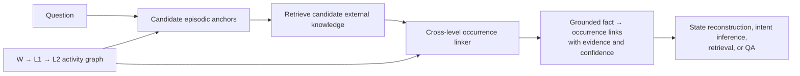

# HMGraph: Hierarchical Knowledge Grounding for Long-Horizon Human Activity Understanding

## 1. One-sentence project definition

Long-video systems can retrieve external knowledge that is generally relevant, but they may apply it to the wrong object, action occurrence, event, or time. HMGraph represents human activity as linked observations, actions, subgoals, and state changes, then grounds each external fact to the exact episodic occurrence supported by that hierarchy.

## 2. What problem are we solving?

Human activity videos are difficult for more than visual-recognition reasons. A long video often contains:

- repeated appearances of similar objects;
- the same action performed many times for different reasons;
- causes and consequences separated by minutes or hours;
- fine visual motions nested inside steps and larger goals;
- object and task states that must be inferred from earlier actions;
- external facts that are correct in general but applicable to only one particular occurrence.

Existing knowledge-augmented systems often answer a question by retrieving facts relevant to the question, sampled frames, or a flat video graph. This answers:

> Is this fact relevant to this question or video?

The missing question is:

> Which specific entity or action occurrence does this fact apply to, at what time and semantic level, and which observations support that link?

Retrieving a correct fact is therefore not enough. The system must create the correct **fact-to-episode link**. A wrong link can produce a plausible answer assembled from unrelated moments—for example, the pan used in one activity, a different pan being washed, and a third pan being stored.

### Formal task

Given a question or information need `q`, a hierarchical episodic graph `G`, and candidate external facts `K`, predict:

```text
(external fact, episodic anchor, relation, time/level, evidence path, confidence)
```

An episodic anchor is a particular persistent entity, action occurrence, state transition, or activity phase—not merely a noun such as `pan` or a generic verb such as `wash`.

## 3. What are we building?

### 3.1 Action-centric episodic hierarchy

The proposed graph represents activity at multiple scales:

- **W — grounded observations:** timestamped visual descriptions, detected entities, attributes, locations, and uncertainty.
- **L1 — micro-actions:** individual actions with participants and candidate pre/post states, linked to their W evidence.
- **L2 — steps or subgoals:** groups of actions such as `roast spices`, `clean cookware`, or `prepare surface for painting`.
- **L3 — task/session goal, when needed:** the larger activity or cross-session context.

The current implementation contains W and L1. L2, persistent state tracking, and the external-knowledge linker are proposed work; L3 is optional unless the chosen long-duration task requires it.

The graph must also contain explicit relations. A hierarchy by itself does not express causality or identity:

```text
SAME_ENTITY, BEFORE, AFTER, PART_OF_ACTIVITY,
CAUSES, ENABLES, CHANGES_STATE, USED_FOR,
SUPPORTED_BY, CONTRADICTS
```

Persistent entity tracking is related to, but distinct from, the hierarchy. Visual and temporal evidence determines whether two observations show the same pan. The hierarchy organizes what happened to that pan and why. When identity evidence is insufficient, the system should lower its confidence or abstain.

### 3.2 Query-conditioned external knowledge

We should not permanently store every possible fact about every visible object. After the question identifies candidate entities/actions, the system retrieves only potentially useful knowledge, including:

- action preconditions and effects;
- object affordances and functional roles;
- procedural expectations;
- common state transitions;
- purpose, cause, and part-whole relations.

Each fact should have a source and confidence. An LLM may structure source text into graph triples, but it should not be the only untraceable source of the fact.

### 3.3 Cross-level occurrence-specific linker

For each candidate fact and episodic anchor, HMGraph scores:

- relevance to the question;
- match to the exact entity/action occurrence;
- support from W observations;
- consistency with the L1 action;
- consistency with the L2/L3 activity context;
- temporal and state-transition consistency;
- persistent-identity evidence;
- contradictions elsewhere in the video.

It then returns a small grounded subgraph, rather than all retrieved facts, to a fixed answer pipeline.



## 4. Two reasoning abilities produced by the same graph

The proposal is not limited to object matching. It supports two complementary directions of reasoning.

### A. Reason forward through consequences

```text
past action → state change → later action → present task/object state
```

This answers questions such as: Was this particular object already cleaned? Where did it end up? What remains to be done?

### B. Reason upward through activity structure

```text
fine observation → micro-action → step/subgoal → larger purpose
```

This answers questions such as: What is this small action trying to accomplish? Which repeated occurrence was performed for this purpose?

The common technical problem is applying a general external fact to the correct local occurrence in a long activity history.

## 5. Real scenarios

### Scenario 1 — Reconstructing the state of one pan over time

**Existing SuperMemory-VQA question:**

> Did I already wash the frying pan I used to roast the spices?

The relevant events are separated:

```text
Pan A used to roast spices
        ↓
Pan A later hand-washed
        ↓
Pan A later stored in a lower cabinet
        ↓
infer: Pan A is clean and put away
```

The video directly shows using, washing, and storing. External commonsense supplies the state interpretation:

```text
hand-wash(cookware) → clean(cookware)
store(clean cookware, cabinet) → put-away(cookware)
```

The hard part is not retrieving those facts. It is proving that the pan washed and stored is the same pan previously used to roast spices. A flat system can accidentally combine `use(Pan A)`, `wash(Pan B)`, and `store(Pan C)` and still generate a plausible answer.

HMGraph should:

1. find the `roast spices` L2 step;
2. identify its participant as Pan A using W/L1 evidence;
3. follow `SAME_ENTITY` links through later activity phases;
4. find `wash(Pan A)` and `store(Pan A)`;
5. attach the state-transition facts specifically to those events;
6. answer using the resulting evidence path—or abstain if Pan A cannot be tracked reliably.

This scenario tests persistent entity history, temporally separated evidence, state reconstruction, and external knowledge together.

### Scenario 2 — Understanding what a small painting action is accomplishing

EgoIntent contains daily activities such as painting, window cleaning, laundry, sorting clothes, repairing, and gardening. Small motions in painting can be visually similar but procedurally different:

```text
touch the painted surface → check whether it is dry or inspect texture
rub the painted surface   → blend or smooth material
press masking tape        → improve adhesion or protect a boundary
```

A short clip may show only a hand touching a surface. The purpose depends on the preceding step, the material state, the next action, and the enclosing subgoal. Generic knowledge about touching, rubbing, or tape is too broad.

HMGraph links the observation to its particular micro-action, the micro-action to the current painting step, and the relevant procedural fact to that occurrence. It therefore reasons from the action history, rather than selecting the most common purpose of `touch`.

This scenario tests micro-action intent and procedural role without restricting the project to cooking or machine assembly.

### Scenario 3 — The same action occurs repeatedly for different purposes

In an HD-EPIC sequence, `stir potatoes` occurs multiple times, with annotated purposes including distributing seasoning, cooking evenly, and preventing burning or sticking. All three external facts are valid facts about stirring. The task is to associate each purpose with the correct stirring occurrence.

HMGraph distinguishes them using their activity histories:

```text
add salt → stir immediately          → distribute seasoning
continue cooking → stir during phase → cook evenly
prolonged heat/risk state → stir      → prevent sticking or burning
```

A question-relevant retriever may return all three facts. The proposed linker uses the preceding state, temporal position, and L2 phase to attach one fact to one occurrence. This is a controlled example of why relevance alone is weaker than occurrence-specific grounding.

### Scenario 4 — Situated knowledge under controlled conditions

SOK-Bench includes questions whose answers depend on both a visible situation and an aligned knowledge subgraph. A published example identifies a white slurry as cornstarch and reasons that omitting it would make a sauce thinner because cornstarch is a thickener.

This is useful for checking whether the system selects the right external fact and connects it to the relevant object/action. However, SOK-Bench situations are short, so it cannot by itself validate the long-video hierarchy. It is a diagnostic benchmark, not the entire project story.

## 6. Why should HMGraph be better than related methods?

| Approach | What it does well | Gap addressed by HMGraph |
|---|---|---|
| Flat text/graph RAG | Retrieves question-relevant video nodes and facts | Similar objects and repeated actions remain mixed; no semantic level or evidence path is enforced |
| M³KG-RAG-style retrieval | Retrieves, prunes, and visually verifies knowledge against sampled frames | Frame-level presence does not establish which persistent occurrence across a long activity the fact explains |
| G2F-RAG | Builds video/knowledge graphs and presents a compact graph to a VLM | It is the strongest direct baseline, but knowledge-to-occurrence attachment is not isolated or directly evaluated as the central task |
| VideoMindPalace / hierarchical long-video memory | Organizes long experience at multiple levels | External fact grounding to a particular entity/action occurrence is not the central objective |
| SOK-Bench systems | Align situated scenes with general/commonsense knowledge | The situations are mostly short and do not test persistent identities and repeated occurrences across long activity histories |
| **HMGraph** | Uses persistent action/state chains plus cross-level evidence | Predicts and evaluates the exact fact → entity/action/time link before the answer is generated |

The defensible claim is narrow:

> HMGraph should outperform flat or sampled-frame grounding when multiple similar entities, repeated actions, or temporally separated evidence compete for the same external fact.

It is not expected to be universally better on every VideoQA question. G2F-RAG is a serious competitor; if it already creates correct links on the targeted hard cases, this claimed contribution is weak and the project should pivot.

## 7. What is innovative?

The project does **not** claim that hierarchy, external knowledge, graph retrieval, or VideoQA is individually new.

The proposed contributions are:

1. **Action-centric episodic representation.** A persistent, state-aware hierarchy links grounded observations to micro-actions, steps, and goals while preserving the evidence for each abstraction. This is an enabling contribution, but hierarchy alone is not sufficient novelty.
2. **Cross-level occurrence-specific knowledge grounding.** This is the main algorithmic contribution: attach an external fact to the exact entity/action/event/time using agreement across fine evidence, action structure, activity context, temporal state, and contradictions.
3. **Direct evaluation of grounding.** Measure whether the correct fact was linked to the correct episodic anchor and evidence interval, then test whether that improvement transfers to natural state, intent, and memory questions using the same downstream answerer.

The central innovation is therefore not merely “hierarchy plus knowledge.” It is:

> **Evidence-backed external-knowledge grounding over a hierarchical, persistent model of human activity.**

## 8. Research questions

- **RQ1:** Under the same retrieval budget and answer model, does the semantic W→L1→L2 hierarchy retrieve the correct episodic anchor more reliably than a flat graph?
- **RQ2:** Does cross-level verification improve the accuracy of external fact-to-anchor links over dense retrieval, flat graph matching, sampled-frame verification, and G2F-RAG-style grounding?
- **RQ3:** Does better link accuracy improve targeted task-state, intent, and evidence-retrieval questions while reducing unsupported answers?
- **RQ4:** Does the benefit grow with temporal distance, number of similar entities, number of repeated actions, and number of plausible external facts?

## 9. Dataset and evaluation plan

No single existing dataset tests the entire claim perfectly. Use complementary datasets rather than forcing all evaluation onto HD-EPIC.

| Dataset | Role | What it tests | Limitation |
|---|---|---|---|
| **SuperMemory-VQA** | Main real long-history evaluation | Persistent entity history, multi-interval evidence, task/object state, intent recall | Direct fact-to-entity links may require a small human-verified evaluation subset |
| **EgoIntent** | Main activity-intent diagnostic | Local intent, procedural intent, and next-step prediction across diverse daily activities | Using ordered prior history is an explicit long-context extension of the original task |
| **SOK-Bench** | Intrinsic knowledge-grounding benchmark | Related objects/actions, aligned knowledge subgraph, rationale, and answer | Short/generated situations; weak test of long memory |
| **S-EMBER or EgoMemory** | Hierarchy and long-evidence ablation | Long temporal retrieval, chronology, repeated events, multi-interval evidence | Many questions require episodic evidence but little external knowledge |
| **HD-EPIC** | Secondary controlled evaluation and current engineering testbed | Repeated action purposes, state-dependent actions, existing timestamps/rationales | Official fine-grained why questions often provide short target clips; full-video use must be described as an adaptation |

### Metrics

**Intrinsic grounding:**

- episodic-anchor Recall@1 and Recall@5;
- external-knowledge Recall@1 and Recall@5;
- joint fact-to-anchor accuracy;
- evidence temporal IoU or evidence-interval recall;
- entity-chain consistency and valid-path rate;
- contradiction rate;
- confidence calibration and abstention quality.

**Downstream:**

- QA accuracy or MRR;
- evidence-retrieval score;
- intent similarity/semantic score where free-form answers are used;
- accuracy stratified by temporal distance, repeated-action count, and number of competing same-class entities.

QA is therefore a downstream usefulness test, not the sole definition of success. If QA rises while link accuracy does not, the answer model may simply be guessing; that result would not support the research claim.

## 10. Controlled comparisons

Use the same question, candidate evidence budget, answer model, and answer prompt wherever possible:

1. no external knowledge;
2. flat text/dense retrieval;
3. flat video graph plus external knowledge;
4. M³KG-RAG-style sampled-frame verification;
5. G2F-RAG-style graph construction/delivery;
6. W only;
7. L1 only;
8. flat W+L1(+L2);
9. proposed hierarchical cross-level linker;
10. shuffled hierarchy;
11. oracle episodic anchor and oracle knowledge upper bounds.

The shuffled-hierarchy test is essential: it shows whether improvement comes from correct human-activity structure rather than simply giving the model more text.

## 11. Implementation plan

### Phase 1 — Feasibility before major engineering

- Select approximately 30–50 hard SuperMemory-VQA examples with separated evidence and competing entities/actions.
- Select approximately 100 EgoIntent examples requiring procedural history rather than only the target clip.
- Select approximately 200 SOK-Bench examples with explicit aligned subgraphs.
- Label or verify the correct episodic anchors and fact-to-anchor links where the dataset does not provide them directly. Keep the original natural questions unchanged.
- Compare a flat baseline, a G2F-style baseline, and a small prototype cross-level linker.

Proceed only if the hierarchy improves link/evidence accuracy on the cases it is designed to solve.

### Phase 2 — Extend the graph

- preserve the existing W and L1 pipeline;
- implement L2 step/subgoal grouping;
- add persistent entity tracks and uncertainty;
- add explicit temporal, state, causal, support, and contradiction edges;
- preserve provenance from every abstract node to timestamps and observations.

### Phase 3 — Knowledge and linking

- retrieve source-backed knowledge at query time;
- normalize knowledge into a small relation schema;
- generate candidate episodic anchors;
- implement cross-level scoring and contradiction checks;
- output a minimal grounded subgraph with confidence.

### Phase 4 — Controlled evaluation

- keep the current RAVU-style retriever/answerer fixed across graph variants;
- run intrinsic link/evidence metrics first;
- run downstream state and intent tasks second;
- audit failures by recognition, identity tracking, knowledge retrieval, attachment, and answer generation.

### Phase 5 — Full-scale study

Scale only after the pilot demonstrates that occurrence misgrounding is frequent enough and that HMGraph addresses it better than strong baselines.

## 12. Falsification criteria

The hypothesis should be rejected or substantially revised if:

- the correct hierarchy does not beat a flat graph under the same evidence/token budget;
- G2F-RAG already produces correct fact-to-occurrence links on the targeted hard subset;
- improvements come only from adding more facts or tokens;
- QA improves without intrinsic link or evidence accuracy improving;
- errors are dominated by visual recognition and re-identification rather than knowledge grounding;
- benefits appear only in short cooking examples and do not transfer to other daily activities.

## 13. Scope and non-claims

This project is:

- about long-horizon human activity understanding;
- about grounding external procedural/commonsense knowledge to observed activity;
- about reconstructing object/task state and understanding micro-action purpose;
- evaluated through direct link/evidence metrics plus natural downstream tasks.

This project is not:

- a claim of overall VideoQA state of the art;
- a generic real-time assistant;
- a claim that hierarchy automatically solves object re-identification;
- unrestricted intention guessing without observable evidence;
- an unlimited knowledge graph containing every fact about every object;
- currently centered on mobile compression or cloud/mobile deployment.

## 14. Advisor-ready summary

Long human activities contain repeated actions, similar objects, and effects that appear long after their causes. Existing knowledge-augmented video systems can retrieve facts relevant to a video or question, but a correct fact can still be connected to the wrong action occurrence or object history. HMGraph represents the episode as persistent entity and action-state chains from observations to actions and subgoals. It then uses evidence at each level to ground external knowledge to the correct entity, event, and time before answering. We will test the grounding link directly and then evaluate whether it improves natural long-memory state questions and micro-action intent questions. The core novelty is occurrence-specific, cross-level external-knowledge grounding for long human activity—not simply another hierarchy or another VideoQA system.

## 15. Working paper title

**HMGraph: Hierarchical Knowledge Grounding for Long-Horizon Human Activity Understanding**

## 16. Primary project and dataset links

- [G2F-RAG (CVPR 2026)](https://openaccess.thecvf.com/content/CVPR2026/html/Yang_Graph-to-Frame_RAG_Visual-Space_Knowledge_Fusion_for_Training-Free_and_Auditable_Video_CVPR_2026_paper.html)
- [M³KG-RAG (CVPR 2026)](https://research.nvidia.com/labs/lpr/publication/park2026m3kgrag/)
- [VideoMindPalace (CVPR 2025)](https://openaccess.thecvf.com/content/CVPR2025/papers/Huang_Building_a_Mind_Palace_Structuring_Environment-Grounded_Semantic_Graphs_for_Effective_CVPR_2025_paper.pdf)
- [SOK-Bench](https://github.com/csbobby/SOK-Bench)
- [SuperMemory-VQA](https://github.com/AIoT-MLSys-Lab/supermemory-vqa)
- [EgoIntent dataset](https://huggingface.co/datasets/py2279105943/EgoIntent)
- [S-EMBER](https://github.com/facebookresearch/S-EMBER)
- [EgoMemory / EgoMemReason](https://egomemory.github.io/)
- [HD-EPIC](https://hd-epic.github.io/)
